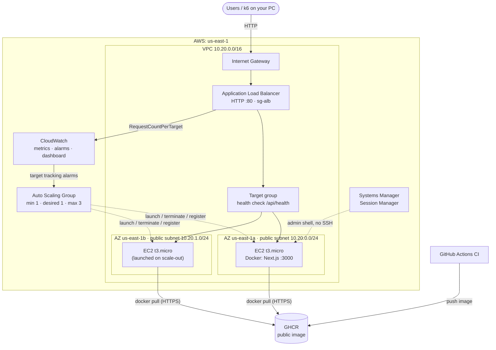
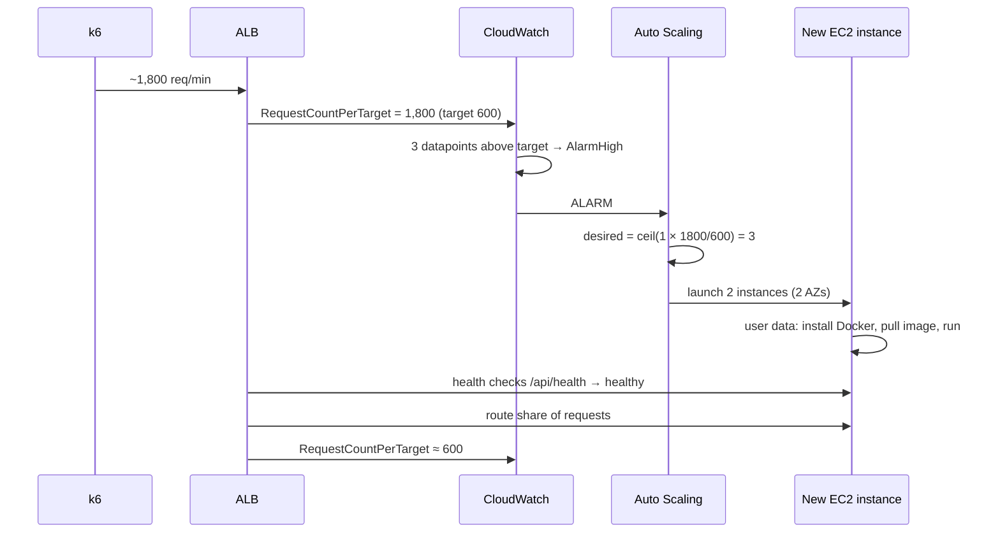

# CloudScale Lab: Load Balancing and Auto-scaling in Cloud using AWS

A university DevOps project that deploys a containerised web application behind an **AWS Application Load
Balancer**, scales it automatically with an **EC2 Auto Scaling Group**, monitors it with **Amazon CloudWatch**,
proves it with **k6** load tests, and defines everything as code with **Terraform** and **GitHub Actions**.

> The web app is just a demonstration workload. The point of the project is the infrastructure, automation,
> monitoring and testing around it.

## Contents

1. [Introduction](#1-introduction)
2. [Objectives](#2-objectives)
3. [Architecture diagram](#3-architecture-diagram)
4. [Technology stack](#4-technology-stack)
5. [AWS architecture explained](#5-aws-architecture-explained)
6. [Application setup](#6-application-setup)
7. [Docker setup](#7-docker-setup)
8. [Terraform setup](#8-terraform-setup)
9. [AWS prerequisites](#9-aws-prerequisites)
10. [Deploying the infrastructure](#10-deploying-the-infrastructure)
11. [Load balancing explained](#11-load-balancing-explained)
12. [Auto Scaling explained](#12-auto-scaling-explained)
13. [CloudWatch dashboard](#13-cloudwatch-dashboard)
14. [k6 load testing](#14-k6-load-testing)
15. [Expected results](#15-expected-results)
16. [CI/CD](#16-cicd)
17. [Cost considerations](#17-cost-considerations)
18. [Cleanup](#18-cleanup)
19. [Troubleshooting](#19-troubleshooting)

Further reading: [docs/PROJECT_DEEP_DIVE.md](docs/PROJECT_DEEP_DIVE.md) (how and why everything works) ·
[docs/DEPLOYMENT_RUNBOOK.md](docs/DEPLOYMENT_RUNBOOK.md) (exact steps and demo script) ·
[docs/COST_ESTIMATE.md](docs/COST_ESTIMATE.md) · [docs/OIDC_OPTIONAL.md](docs/OIDC_OPTIONAL.md) ·
[load-testing/README.md](load-testing/README.md)

---

## 1. Introduction

**CloudScale Lab** is a small Next.js web app that shows *which EC2 instance served your request*. It runs on a
fleet of identical EC2 instances behind an Application Load Balancer. When traffic increases, AWS adds instances;
when it falls, AWS removes them. Reload the page, or use its built-in distribution tester, and you can watch
requests being spread across instances in two Availability Zones.

## 2. Objectives

| # | Objective | Where it's implemented |
|---|---|---|
| 1 | Infrastructure as Code | `infrastructure/terraform/` |
| 2 | EC2 provisioning | `launch-template.tf`, `templates/user-data.sh.tftpl` |
| 3 | Application Load Balancer | `load-balancer.tf` |
| 4 | EC2 Auto Scaling Group | `autoscaling.tf` |
| 5 | Automatic scale-out and scale-in | Target tracking on `ALBRequestCountPerTarget` |
| 6 | Load testing and traffic distribution | `load-testing/k6-load-test.js`, `scripts/check-distribution.ps1` |
| 7 | Monitoring and analysis | `monitoring.tf` (dashboard and alarms) |
| 8 | Containerisation | `Dockerfile`, `docker-compose.yml` |
| 9 | CI/CD | `.github/workflows/ci.yml` |
| 10 | Cost-conscious design | No NAT/EIP/RDS, capped capacity, [cost estimate](docs/COST_ESTIMATE.md), cleanup scripts |

## 3. Architecture diagram



How a scale-out unfolds over time:



## 4. Technology stack

| Technology | Role | Why it was chosen |
|---|---|---|
| **AWS EC2** (t3.micro, Amazon Linux 2023) | Runs the app | Free-tier-eligible type (verify for your account); AL2023 has the SSM agent and Docker packages |
| **Elastic Load Balancing (ALB)** | Distributes HTTP requests | Layer-7 routing, HTTP health checks, per-request balancing, publishes `RequestCountPerTarget` |
| **EC2 Auto Scaling** | Adds/removes instances | Native AWS scaling with target tracking (no custom scripts) |
| **Amazon CloudWatch** | Metrics, alarms, dashboard | Built-in metrics from ALB/ASG/EC2, with no agent and no custom metrics |
| **Amazon VPC** | Network isolation | Public subnets + security groups; no NAT Gateway to keep cost low |
| **AWS IAM** | Permissions | Least-privilege instance role (SSM only), scoped deployer policy |
| **AWS Systems Manager** | Admin access | Session Manager shell without SSH keys or open port 22 |
| **Terraform** | Infrastructure as Code | Declarative, reviewable `plan`, reproducible, one-command `destroy` |
| **Docker** | Packaging | Same image locally, in CI and on EC2; multi-stage build, ~71 MB |
| **GitHub Container Registry** | Image hosting | Free for public images; anonymous pulls mean no credentials on EC2 |
| **GitHub Actions** | CI | Free for public repos; lint/build/test/publish on every push |
| **Next.js 16 (App Router) + Node.js 24 LTS** | Demo web app | Small, stateless, server-rendered; one codebase serves the UI and the API |
| **k6** | Load testing | Scriptable scenarios, latency percentiles, runs locally |

## 5. AWS architecture explained

- **VPC** `10.20.0.0/16` with **two public subnets** in two Availability Zones. An ALB requires at least two AZs,
  and two AZs also give the app zone-level redundancy.
- **Internet Gateway** + a route table sending `0.0.0.0/0` to it, so both the ALB and the instances can reach
  the internet.
- **No NAT Gateway:** instances sit in public subnets with public IPs so they can download Docker and the image.
  Their security group still **only accepts traffic from the ALB**, so nothing on the internet can reach them
  directly. This is a deliberate cost/complexity trade-off for a demo. Production would use private subnets.
- **ALB** (internet-facing, port 80) → **listener** → **target group** (port 3000, health check `/api/health`).
- **Launch template** defines each instance: AL2023 AMI, `t3.micro`, 8 GiB encrypted gp3, IMDSv2 only,
  unlimited CPU credits (see [§17](#17-cost-considerations)), SSM-only IAM role, and **user data** that installs
  Docker and runs the container.
- **Auto Scaling Group** across both subnets, min 1 / desired 1 / max 3, `ELB` health checks, attached to the
  target group, with a **target tracking policy** of 600 requests per target per minute.
- **CloudWatch** dashboard + 4 alarms, plus 2 alarms that the scaling policy manages automatically.

Details: [docs/PROJECT_DEEP_DIVE.md](docs/PROJECT_DEEP_DIVE.md).

## 6. Application setup

```
app/
├── app/
│   ├── page.tsx              # homepage (server-rendered on every request)
│   ├── layout.tsx, globals.css
│   └── api/
│       ├── health/route.ts   # GET /api/health   → 200 {"status":"ok"} (ALB health check)
│       └── instance/route.ts # GET /api/instance → instance ID, AZ, hostname, timestamp
├── components/               # InstanceCard, HealthBadge, LiveDistribution, ScalingInfo, HowItWorks
└── lib/
    ├── metadata.ts           # IMDSv2 client with local fallback
    └── config.ts             # scaling config from env vars, no-store headers
```

Run locally (Node.js 24):

```powershell
cd app
npm ci
npm run dev        # http://localhost:3000
npm run check      # lint + type-check
npm run build      # production build
```

Key behaviours:
- **IMDSv2:** `lib/metadata.ts` first `PUT`s `/latest/api/token`, then reads `instance-id`,
  `placement/availability-zone` and `local-hostname` with the token. The result is cached in memory, because
  these values never change for an instance.
- **Local fallback:** off EC2 the metadata call fails within ~1 s and the app shows `local-dev` / `local`
  (`source: "local-fallback"`), then retries every 30 s. Set `DISABLE_IMDS=true` to skip the attempt entirely.
- **No caching:** all routes use `dynamic = "force-dynamic"` and send `Cache-Control: no-store`, so every
  response really comes from the instance that handled that request.
- **Configuration** shown on the page comes from env vars injected by Terraform: `ASG_MIN`, `ASG_DESIRED`,
  `ASG_MAX`, `SCALING_TARGET`, `INSTANCE_TYPE`, `AWS_REGION`, `APP_VERSION`.

## 7. Docker setup

```powershell
# Build for EC2's CPU architecture (t3 = x86_64)
docker build --platform linux/amd64 -t cloudscale-lab:local .

# Or build + run with compose (simulated scaling env vars)
docker compose up --build
curl.exe http://localhost:3000/api/health
curl.exe http://localhost:3000/api/instance
docker compose down
```

The `Dockerfile` is a **3-stage build**:
1. `deps`: `npm ci` from the lockfile (reproducible).
2. `builder`: `next build` with `output: "standalone"` (bundles only the files needed at runtime).
3. `runner`: `node:24-alpine`, copies only the standalone server + static assets, runs as the non-root `node`
   user, and has a `HEALTHCHECK` against `/api/health`.

The result is about **71 MB**. `.dockerignore` uses an allow-list, so only `app/` (without `node_modules`/`.next`)
is sent to the build.

## 8. Terraform setup

```
infrastructure/terraform/
├── versions.tf          # Terraform >= 1.9, AWS provider ~> 6.0
├── providers.tf         # region + default tags (Project/Environment/ManagedBy)
├── main.tf              # locals, AZ lookup, Amazon Linux 2023 AMI lookup
├── variables.tf         # every tunable value, with validation
├── networking.tf        # VPC, 2 public subnets, IGW, routes
├── security.tf          # security groups + rules, IAM role/instance profile
├── load-balancer.tf     # ALB, target group, listener
├── launch-template.tf   # instance blueprint
├── templates/user-data.sh.tftpl   # boot script
├── autoscaling.tf       # ASG + target tracking policy (+ optional CPU policy)
├── monitoring.tf        # dashboard, alarms, optional SNS e-mail
├── outputs.tf           # ALB URL, ASG name, dashboard link, k6 command
└── terraform.tfvars.example
```

```powershell
winget install --id Hashicorp.Terraform -e
cd infrastructure/terraform
terraform init       # downloads the AWS provider
terraform fmt -recursive
terraform validate
```

State is stored **locally** in `terraform.tfstate`, which is git-ignored and must never be committed. That's fine
for a single-person project; teams would use a remote backend.

Main variables (see `terraform.tfvars.example`):

| Variable | Default | Purpose |
|---|---|---|
| `container_image` | *(required)* | e.g. `ghcr.io/<user>/cloudscale-lab:sha-1a2b3c4` |
| `aws_region` | `us-east-1` | Region |
| `instance_type` | `t3.micro` | Must be x86_64 and allowed on your plan |
| `asg_min_size` / `asg_desired_capacity` / `asg_max_size` | 1 / 1 / 3 | Capacity (max is validated ≤ 4 as a cost guard) |
| `requests_per_target_per_minute` | 600 | Scaling target |
| `health_check_grace_period` / `instance_warmup` | 300 / 120 s | Boot allowances |
| `cpu_credits` | `unlimited` | T3 credit mode (`standard` throttles new instances; see §17) |
| `enable_cpu_policy` | false | Optional CPU-based policy experiment |
| `detailed_monitoring` | false | Paid 1-minute EC2 metrics |
| `allowed_http_cidrs` | `["0.0.0.0/0"]` | Who can reach the ALB |
| `alarm_email` | `""` | Optional SNS e-mail notifications |

## 9. AWS prerequisites

1. **AWS account on the Free plan.** Check your credits and plan end date first. See
   [COST_ESTIMATE.md §5](docs/COST_ESTIMATE.md#5-checking-credits-free-plan-time-and-billing-aws-console).
   An STS identity check does *not* tell you which plan you're on.
2. **Budget alert** created (zero-spend or $5).
3. **IAM user** `cloudscale-deployer` with [docs/iam/deployer-policy.json](docs/iam/deployer-policy.json).
   Never use root access keys.
4. **AWS CLI v2** configured: `winget install --id Amazon.AWSCLI -e`, then `aws configure` (region `us-east-1`).
5. **A public GHCR image**: push to GitHub and make the package public (see [§16](#16-cicd)).
6. **Pre-flight check:** `./scripts/preflight-check.ps1 -Image ghcr.io/<user>/cloudscale-lab:<tag>`. It checks
   free-tier eligibility of `t3.micro`, the vCPU quota (needs ≥ 6) and anonymous image pulls.

## 10. Deploying the infrastructure

The full checklist is in [docs/DEPLOYMENT_RUNBOOK.md](docs/DEPLOYMENT_RUNBOOK.md). In short:

```powershell
cd infrastructure/terraform
Copy-Item terraform.tfvars.example terraform.tfvars   # set container_image
terraform init
terraform plan -out tfplan        # review: 28 to add, no NAT/EIP/RDS
terraform apply tfplan            # ⚠ creates billable resources
terraform output
```

Validate:

```powershell
$alb = terraform output -raw alb_url
curl.exe -s "$alb/api/health"
curl.exe -s "$alb/api/instance"
aws elbv2 describe-target-health --target-group-arn (terraform output -raw target_group_arn) --output table
```

## 11. Load balancing explained

- The ALB is the single public entry point. It **terminates each HTTP request** and opens a new one to a target.
- It sends requests only to **healthy** targets in the target group, using **round robin**. Cross-zone load
  balancing spreads load evenly across all instances in both AZs.
- **Health checks** every 15 s on `/api/health`: 2 successes → healthy, 2 failures → unhealthy and removed from
  rotation.
- Because each request is routed independently, consecutive requests from one browser can reach different
  instances. This is visible on the homepage and in `/api/instance`.
- **Deregistration delay (30 s)** lets in-flight requests finish when an instance is removed during scale-in.

## 12. Auto Scaling explained

- The **Auto Scaling Group** keeps the number of healthy instances between **min 1** and **max 3**, replacing any
  that fail ALB health checks (`health_check_type = "ELB"`).
- The **target tracking policy** keeps `ALBRequestCountPerTarget` near **600 req/min per instance**:
  - **Scale-out:** 3 consecutive minutes above target → desired = `ceil(current × actual / target)`, capped at max.
  - **Scale-in:** 15 consecutive minutes well below target → instances are drained and terminated, down to min.
- **Grace period (300 s)** stops new instances from being killed while they're still installing Docker.
  **Warm-up (120 s)** keeps them out of the metric until they're ready.
- `desired_capacity` is ignored by Terraform after creation, because Auto Scaling owns it.
- **Request count vs CPU:** request count is a direct, 1-minute, free measure of demand. CPU is indirect and
  (with basic monitoring) only 5-minute. Set `enable_cpu_policy = true` to experiment. With both policies, the
  ASG scales out if *either* wants to and scales in only when *both* agree. It adds 2 more alarms.

## 13. CloudWatch dashboard

After `apply`, open `terraform output -raw dashboard_url`. Set the time range to **1h** and auto-refresh to **10s**.

| Widget | Metric(s) | Healthy steady state | During a spike |
|---|---|---|---|
| Current state | In-service, desired, healthy/unhealthy targets, requests/min | 1 / 1 / 1 / 0 | Desired jumps to 3; healthy follows a few minutes later |
| Requests per target vs target | `RequestCountPerTarget` (Sum, 1 min) + orange line at 600 | Well below the line | Crosses the line → triggers scaling → falls back near the line |
| ASG capacity | `GroupDesiredCapacity`, `GroupInServiceInstances`, `GroupPendingInstances`, `GroupTerminatingInstances` | Flat at 1 | Desired steps up; Pending appears; In-service follows |
| Target health | `HealthyHostCount` (min), `UnHealthyHostCount` (max) | Healthy = in-service, Unhealthy = 0 | Healthy rises as new instances pass checks |
| Response time | `TargetResponseTime` avg and p95 | A few ms | May rise slightly before new capacity arrives |
| Requests and errors | `RequestCount`, `HTTPCode_Target_2XX/5XX_Count`, `HTTPCode_ELB_5XX_Count` | 5XX = 0 | 2XX rises with load; 5XX should stay 0 |
| EC2 CPU / Network | `CPUUtilization`, `NetworkIn/Out` aggregated by ASG (5-min) | Low | Rises, then spreads across instances |
| Alarms | The 4 project alarms | All OK | All OK (scaling alarms live under CloudWatch → Alarms as `TargetTracking-*`) |

**ALB metrics only appear while requests are flowing.** On an idle site the load-balancer widgets go blank
(no datapoints, not zero), and the scaling alarms show `INSUFFICIENT_DATA`. Keep some traffic running during the
demo, even just the normal k6 scenario. This is also why the alarms treat missing data as "not breaching".

**Scaling activities** aren't a metric. Read them in EC2 → Auto Scaling Groups → *Activity* tab
(`terraform output asg_console_url`), or live with `./scripts/watch-scaling.ps1`.

**Identifying unhealthy instances:** the *unhealthy-targets* alarm fires, `UnHealthyHostCount > 0` appears on the
dashboard, and `aws elbv2 describe-target-health` shows the instance with a `Reason` (e.g.
`Target.ResponseCodeMismatch`, `Target.Timeout`). Auto Scaling then replaces it automatically.

Alarms created:

| Alarm | Condition | Meaning |
|---|---|---|
| `…-unhealthy-targets` | UnHealthyHostCount > 0 for 2 min | An instance is failing health checks |
| `…-no-healthy-targets` | HealthyHostCount < 1 for 2 min | Site down (ALB returns 503) |
| `…-target-5xx` | Target 5XX > 5/min for 2 min | App is erroring |
| `…-high-latency-p95` | p95 response time > 1 s for 3 min | App is slow / overloaded |

## 14. k6 load testing

```powershell
winget install --id GrafanaLabs.k6 -e
$alb = terraform -chdir=infrastructure/terraform output -raw alb_url
k6 run -e BASE_URL=$alb -e SCENARIO=normal       load-testing/k6-load-test.js  # A
k6 run -e BASE_URL=$alb -e SCENARIO=spike        load-testing/k6-load-test.js  # B
k6 run -e BASE_URL=$alb -e SCENARIO=scalein      load-testing/k6-load-test.js  # C
k6 run -e BASE_URL=$alb -e SCENARIO=distribution load-testing/k6-load-test.js  # D
./scripts/check-distribution.ps1                                                # D (table view)
```

Each run prints average and p95 latency, request rate and error rate, and saves JSON to `load-testing/results/`.
Thresholds: error rate < 1%, p95 < 1 s, checks > 99%. Details: [load-testing/README.md](load-testing/README.md).

## 15. Expected results

| Scenario | Expected observation | Evidence to capture |
|---|---|---|
| A: normal (~180 req/min) | 1 instance serves everything; no scaling activity | k6 summary; dashboard flat at 1 |
| B: spike (~1,500–1,800 req/min) | Within ~3–4 min, desired → 3; within ~3–5 more min, 3 healthy targets | ASG Activity tab ("Launching a new EC2 instance…"); capacity widget |
| D: distribution | Responses from 2–3 distinct `i-…` IDs across `us-east-1a`/`1b` | `check-distribution.ps1` table; homepage tester |
| C: scale-in (~30 req/min) | After ~15 min below target, capacity steps down to 1; targets go `draining` | Activity tab ("Terminating EC2 instance…"); capacity widget |
| Failure test (optional) | `docker stop` on one instance → unhealthy → replaced automatically | Unhealthy alarm, Activity tab |

> **Local vs AWS:** the app, container, Terraform validation and k6 scripts have been **tested locally**.
> The AWS behaviours above are **expected** results. They are verified only once you deploy and run the scenarios.

## 16. CI/CD

`.github/workflows/ci.yml` runs on pull requests and pushes to `main`:

| Job | Steps |
|---|---|
| `app` | `npm ci` → ESLint → TypeScript check → `next build` |
| `terraform` | `terraform fmt -check` → `init -backend=false` → `validate` (no AWS credentials) |
| `docker` | Buildx build for `linux/amd64` → **smoke test** (run the container, curl `/api/health`, `/api/instance`, `/`) → *(main only)* push `ghcr.io/<owner>/cloudscale-lab:latest` and `:sha-<commit>` |

Setup:
1. Create a **public** GitHub repo named **`cloudscale-lab`** and push.
2. No secrets are needed. The workflow uses the built-in `GITHUB_TOKEN` with `packages: write`.
3. After the first successful run on `main`: GitHub → Packages → `cloudscale-lab` → *Package settings* →
   **Change visibility → Public**. EC2 instances pull anonymously.
4. Use the immutable `sha-…` tag in `terraform.tfvars`, so every instance (including ones launched later by
   scaling) runs exactly the same build.

**Deployment** remains a reviewed manual `terraform apply`. Automating rollouts with GitHub OIDC (no stored AWS
keys) is documented as an optional phase in [docs/OIDC_OPTIONAL.md](docs/OIDC_OPTIONAL.md).

## 17. Cost considerations

Approximate figures at us-east-1 list prices (verify in the AWS Pricing Calculator). On the Free plan, these
are paid from credits:

| Scenario | Estimate |
|---|---|
| Per hour, 1 instance | ≈ $0.057 |
| Per hour, 3 instances | ≈ $0.090 |
| 1-hour test | ≈ $0.06–0.09 |
| 3-hour demo | ≈ $0.18–0.27 |
| **Forgotten for a month** | **≈ $41–65** |

The biggest contributors are the **ALB** (billed even when idle) and **public IPv4 addresses** ($0.005/h each:
2 for the ALB + 1 per instance). Built-in protections: no NAT Gateway, max 3 instances, no detailed monitoring,
and 1 dashboard + 4 alarms within the always-free allowance.

**CPU credits, a lesson from the real deployment:** the first version used `cpu_credits = "standard"` to rule out
surplus-credit charges. On AWS, newly launched t3.micro instances then had a credit balance of 0 and were throttled
to their 10% baseline (`CPUCreditBalance = 0`, `CPUUtilization ≈ 10%`). Installing Docker took over 4 minutes,
new instances failed their health checks, and they were replaced in a loop, which would also break scale-out. The
project now uses `unlimited`. CPU above baseline is billed at **$0.05 per vCPU-hour**: about $0.005 per instance
boot, a few cents for a load-test session, and at most about $0.09/hour per instance running flat out.
Full breakdown: [docs/COST_ESTIMATE.md](docs/COST_ESTIMATE.md). **This project is not free to leave running.**

## 18. Cleanup

Do this **on the same day** as your demo:

```powershell
cd infrastructure/terraform
terraform destroy                 # review, then type "yes" (~3–5 min)
cd ../..
./scripts/verify-cleanup.ps1      # read-only; every line should say "none"
```

Then:
- Check Billing → Bills the next day.
- Delete the deployer's access key when the project is finished.
- Optionally delete the GHCR package and GitHub repo.

If `destroy` fails part-way, run it again. Terraform resumes with whatever is left.

## 19. Troubleshooting

| Symptom | Likely cause | Fix |
|---|---|---|
| `terraform apply`: *"not eligible for Free Tier"* / *"instance type not supported on your plan"* | Free-plan accounts can only launch eligible types | Run `preflight-check.ps1`; pick an eligible x86_64 type in `instance_type` |
| *"You have requested more vCPU capacity than your current vCPU limit"* | Low On-Demand vCPU quota | Lower `asg_max_size`, or request a quota increase (Service Quotas, free) |
| Targets stuck `unhealthy`, instances replaced repeatedly | Image can't be pulled (package private / wrong tag), or the container fails | Make the GHCR package public; check `container_image`; in Session Manager: `sudo cat /var/log/cloudscale-userdata.log` |
| New instances stay `unhealthy` and are replaced in a loop; console log shows `dnf install docker` crawling | T3 `standard` credits: a new instance has `CPUCreditBalance = 0` and is throttled to 10% CPU | `cpu_credits = "unlimited"` (default now) and `health_check_grace_period = 300` |
| ALB returns **503** | No healthy targets yet (still booting) or all failing | Wait 3–5 min after apply; check target health and its `Reason` |
| ALB returns **502** | Container crashed or answered with garbage | `sudo docker logs cloudscale` via Session Manager |
| ALB URL times out | Your IP isn't in `allowed_http_cidrs`, or you used `https://` | Use `http://`; check the variable |
| `no-healthy-targets` alarm in ALARM although the target is healthy | (Fixed) ALB publishes no metrics while idle; older config treated missing data as breaching | `treat_missing_data = "notBreaching"`, then `terraform apply` |
| `/api/instance` shows `local-dev` **on EC2** | IMDS unreachable from the container | Launch template must have `http_put_response_hop_limit = 2` and `http_tokens = "required"` |
| No scale-out during the spike | Load below target (internet latency reduces k6 rate) or not sustained ≥ 3 min | Check the dashboard; raise spike VUs or lower `requests_per_target_per_minute` |
| No scale-in after the test | Traffic stopped completely → no metric datapoints → `INSUFFICIENT_DATA` | Run `SCENARIO=scalein` (keeps a trickle) for 20+ min |
| Scaled only to 2, not 3 | Actual load ≈ 1,200 req/min → `ceil(1200/600) = 2` | Expected maths; raise VUs if you want 3 |
| Session Manager "not connected" | Instance still booting, or no outbound HTTPS | Wait ~2 min; `sg-app` must allow 443 out; role must have `AmazonSSMManagedInstanceCore` |
| User data errors with `$'\r': command not found` | Template saved with Windows CRLF line endings | `.gitattributes` forces LF and Terraform strips `\r`; re-clone if edited manually |
| `terraform destroy` hangs on the security group | ENIs still attached while the ALB/instances finish deleting | Wait and re-run `destroy` |
| CI publish step: `denied: permission_denied` | Workflow lacks package permission, or the package is owned by another repo | Repo → Settings → Actions → Workflow permissions; package settings → *Manage Actions access* |
