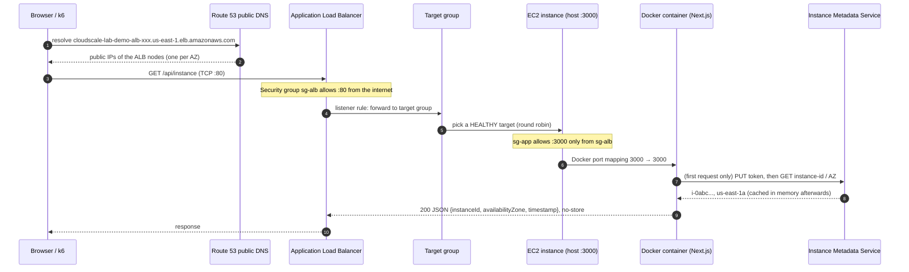
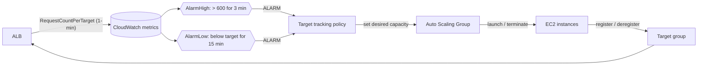
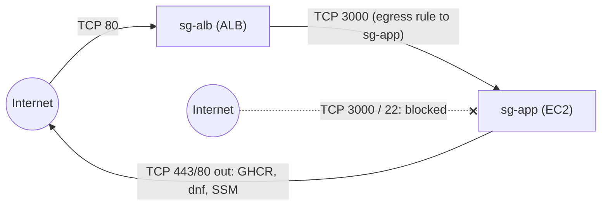
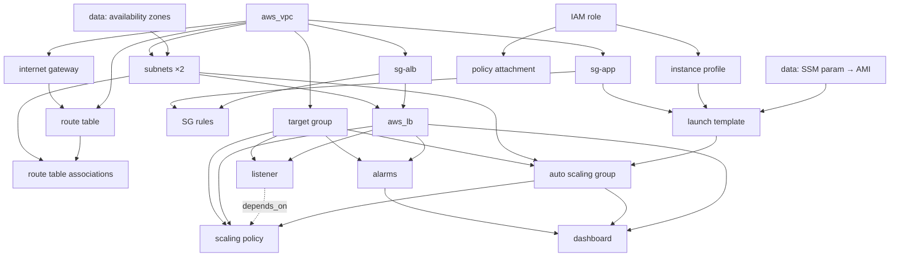

# CloudScale Lab: Project Deep Dive

This document explains *how and why* everything works, so you can answer any question about it during your
demonstration. Read it alongside the Terraform files in `infrastructure/terraform/`.

---

## 1. What happens when a user sends an HTTP request?

Step by step:
1. **DNS.** The ALB's DNS name resolves to the public IPs of ALB nodes in each enabled Availability Zone.
2. **ALB listener.** The ALB listens on port 80. Its single listener rule forwards every request to the target group.
3. **Target selection.** The ALB considers only targets in the `healthy` state and spreads requests between them
   (round robin). The ALB routes *each HTTP request* individually, so even one keep-alive connection can reach
   different instances.
4. **Instance.** The ALB opens a connection to the instance's private IP on port 3000. The instance's security
   group allows this only because the source is the ALB's security group.
5. **Container.** Docker forwards host port 3000 to the Next.js server inside the container.
6. **Metadata.** The app asks the EC2 Instance Metadata Service (IMDSv2) for its instance ID and AZ, once, then
   caches them in memory.
7. **Response.** The JSON goes back through the ALB to the client with `Cache-Control: no-store`, so no browser or
   proxy reuses an old answer. That's what makes the instance ID meaningful for every single request.

## 2. How does the ALB choose a healthy target?

- The **target group** holds a list of registered targets (EC2 instance IDs + port 3000).
- Each target has a **health state**: `initial` (just registered, being checked), `healthy`, `unhealthy`,
  `draining` (being removed), or `unused`.
- The ALB sends traffic **only to `healthy` targets**, using the **round robin** algorithm
  (`load_balancing_algorithm_type = "round_robin"`): requests are taken in turn by each healthy target.
- **Cross-zone load balancing** is always on for ALBs, so an ALB node in us-east-1a can send to a target in
  us-east-1b. Traffic is therefore spread evenly across *instances*, not just across zones.
- **Fail-open:** if *every* target is unhealthy, the ALB sends requests to all of them anyway (better than
  nothing). If there are *no registered targets at all*, the ALB returns **HTTP 503**.

## 3. How do target groups and health checks work?

Configured in `load-balancer.tf`:

| Setting | Value | Meaning |
|---|---|---|
| `path` | `/api/health` | URL the ALB requests on each target |
| `matcher` | `200` | Only HTTP 200 counts as success |
| `interval` | 15 s | Time between checks, per target |
| `timeout` | 5 s | No answer within 5 s = failure |
| `healthy_threshold` | 2 | 2 consecutive successes → `healthy` (~30 s) |
| `unhealthy_threshold` | 2 | 2 consecutive failures → `unhealthy` (~30 s) |
| `deregistration_delay` | 30 s | When a target is removed, existing requests get 30 s to finish |

`/api/health` is intentionally trivial: it doesn't call IMDS or anything external. A health check should answer
"can this process serve HTTP?" A slow dependency shouldn't make a working instance look broken.

There are **two layers** of health checking:
- **ALB health checks** decide *routing* (send traffic or not).
- **Auto Scaling health checks** decide *replacement*. With `health_check_type = "ELB"`, Auto Scaling also treats
  an instance that fails ALB health checks as unhealthy and **terminates and replaces it**, but only after the
  `health_check_grace_period` (180 s), which gives a newly booted instance time to install Docker and pull the image.

## 4. How does EC2 Auto Scaling decide to launch another instance?

The scaling policy (`autoscaling.tf`) is **target tracking** on `ALBRequestCountPerTarget`:

> "Keep the number of requests each instance receives per minute close to **600**."

1. Every minute, the ALB publishes `RequestCountPerTarget` (total requests ÷ healthy targets) to CloudWatch.
2. Creating the policy made AWS automatically create two CloudWatch alarms (you'll see them in CloudWatch → Alarms
   with names starting `TargetTracking-`):
   - **AlarmHigh**: metric > target for **3 consecutive 1-minute datapoints** → scale out.
   - **AlarmLow**: metric well below target for **15 consecutive datapoints** → scale in.
3. When AlarmHigh fires, Auto Scaling calculates the needed capacity roughly as
   `ceil(current_capacity × actual_value / target_value)`.
   Example: 1 instance receiving 1,800 req/min → `ceil(1 × 1800 / 600) = 3`, so desired capacity becomes 3.
4. The result is clamped to `[min_size, max_size]` = `[1, 3]`. This **max is the cost ceiling**.
5. Auto Scaling launches instances from the **launch template**, spread across both AZs' subnets, and registers
   them in the target group. They start `initial`, run user data (Docker install, image pull, container start),
   pass 2 health checks, and become `healthy`.
6. **Instance warm-up** (`default_instance_warmup = 120 s`) excludes brand-new instances from the metric while
   they start, so the policy doesn't overreact while they aren't yet carrying load.

Timeline you can expect in a demo: ~3 min of sustained load → scaling decision → ~2–4 min boot and health checks →
new targets serving traffic.

## 5. How do scaling policies interact with CloudWatch metrics?

- CloudWatch is the **sensor**, the alarms are the **trigger**, the policy is the **controller** and the ASG is
  the **actuator**. It's a feedback loop: more instances lower requests per target, which settles the metric back
  near the target.
- Auto Scaling **owns** the managed alarms. Never edit or delete them by hand; Terraform deletes them along with
  the policy.
- The project's own alarms (unhealthy targets, no healthy targets, 5XX, latency) only **notify**. They take
  no scaling action.
- **Request count vs CPU:** `ALBRequestCountPerTarget` measures demand directly, every minute, for free.
  `ASGAverageCPUUtilization` measures a *symptom* of demand. With free basic monitoring it updates only every
  5 minutes, so it reacts slower, and this app uses very little CPU per request. CPU is the better metric for
  CPU-heavy work (e.g. video encoding). The optional `enable_cpu_policy = true` lets you compare: with two policies,
  Auto Scaling **scales out if either asks** and **scales in only if both agree**.

## 6. What happens when traffic decreases?

1. Requests per target drop below the target.
2. After **15 consecutive minutes** low, AlarmLow fires. Scale-in is deliberately slower than scale-out to
   avoid "flapping" (rapidly adding and removing instances).
3. Auto Scaling lowers desired capacity (gradually, never below `min_size = 1`).
4. It picks an instance to terminate, using the default termination policy: balance across AZs first, then
   prefer the oldest launch template/configuration, then the instance closest to the next billing hour.
5. The instance is **deregistered** from the target group → state `draining` → the ALB stops sending *new*
   requests to it, and in-flight requests get up to `deregistration_delay` (30 s) to complete.
6. The instance is terminated, and its EBS volume and public IP are released (no more charges for them).

Important: if traffic drops to **zero**, the metric has no datapoints. AlarmLow goes to `INSUFFICIENT_DATA`, not
`ALARM`, and **scale-in doesn't happen**. That's why k6 scenario C keeps a small trickle of requests.

## 7. What happens when an EC2 instance becomes unhealthy?

Example: the container crashes and won't restart, or someone runs `docker stop cloudscale`.

1. `/api/health` stops answering → 2 failed checks (~30 s) → target state `unhealthy`.
2. The ALB **immediately stops routing** to it. Users keep being served by the remaining healthy targets.
3. CloudWatch `UnHealthyHostCount` becomes 1 → the `cloudscale-lab-demo-unhealthy-targets` alarm goes to `ALARM`.
4. Because the ASG uses `health_check_type = "ELB"`, Auto Scaling marks the instance `Unhealthy`, **terminates
   it, and launches a replacement** to keep desired capacity.
5. The replacement boots, passes health checks, and the alarm returns to `OK`.

This is **self-healing**: no human action needed. With only 1 instance there's a short outage (ALB returns 503)
until the replacement is healthy, which is a good argument for `min_size = 2` in real production.

`--restart unless-stopped` provides a first line of defence. If the Node.js process crashes, Docker restarts
it within seconds, often before the ALB even notices.

## 8. Why must the application be stateless?

Consecutive requests from the same user can land on **different instances**, and instances are **created and
destroyed automatically**. So:

- Anything stored in one instance's memory or disk (sessions, uploaded files, counters) is **invisible to the
  others** and **lost on scale-in**.
- Our app keeps no user state. Every instance computes the same answer from its environment, and the only
  per-instance data is the instance identity, which is exactly what we want to show.
- If state were needed, it would go into a shared external service (e.g. ElastiCache for sessions, S3 for
  files, a database for records). Alternatively, ALB **sticky sessions** would pin a user to one instance, but that
  undermines even load distribution and is deliberately not enabled here.

## 9. Why was a database intentionally omitted?

- **The assignment is about infrastructure**: load balancing, scaling, monitoring. A database adds nothing to
  that demonstration.
- **Cost:** RDS isn't needed, and even small instances bill continuously.
- **Complexity:** a database needs private subnets, credentials and secret management, backups and migrations.
  All of that is unrelated work and adds risk.
- **Scaling clarity:** the web tier scales horizontally only *because* it's stateless. A shared database would
  become the next bottleneck and would need its own scaling story.

## 10. Security group relationships

| Rule | Why |
|---|---|
| `sg-alb` inbound 80 from `allowed_http_cidrs` (default `0.0.0.0/0`) | Public website |
| `sg-alb` outbound 3000 **to sg-app only** | The ALB has no reason to talk to anything else |
| `sg-app` inbound 3000 **from sg-alb only** | Instances have public IPs (for outbound access) but can't be reached directly. Requests must go through the ALB |
| `sg-app` outbound 443 and 80 | Pull the image from GHCR, install Docker from AWS repos, talk to Systems Manager |
| **No port 22 anywhere** | Admin access uses SSM Session Manager (IAM-authenticated, logged, no keys, no open port) |

Rules reference **security groups, not IP addresses**. When Auto Scaling adds an instance it automatically gets
`sg-app`, so the ALB can reach it immediately, with no rule changes needed.

Other hardening:
- **IMDSv2 required** (`http_tokens = "required"`) protects against SSRF attacks that try to steal instance
  credentials via simple GET requests. Hop limit 2 lets the containerised app (one extra network hop) still reach IMDS.
- **Encrypted EBS** volumes.
- The instance IAM role grants **only** `AmazonSSMManagedInstanceCore`. The app needs no AWS API access.
- The container runs as the **non-root `node` user**.
- `drop_invalid_header_fields = true` on the ALB.

## 11. Terraform resources and their dependencies

### Every resource, in plain language

| File | Resource | What it is |
|---|---|---|
| main.tf | `data.aws_availability_zones` | Asks AWS which AZs exist; we use the first two |
| main.tf | `data.aws_ssm_parameter` + `data.aws_ami` | Finds the newest Amazon Linux 2023 image and its root device name |
| networking.tf | `aws_vpc.main` | Your private network (10.20.0.0/16) |
| networking.tf | `aws_internet_gateway.main` | The VPC's door to the internet |
| networking.tf | `aws_subnet.public[0..1]` | One /24 network per AZ; instances and ALB nodes live here |
| networking.tf | `aws_route_table.public` + associations | "Send internet-bound traffic to the internet gateway" |
| security.tf | `aws_security_group.alb` / `.app` | Firewalls for the ALB and for instances |
| security.tf | `aws_vpc_security_group_*_rule` | The individual allow rules described above |
| security.tf | `aws_iam_role.instance` (+ attachment, instance profile) | Identity the instances run as (SSM access only). An instance profile is the "container" that attaches a role to EC2 |
| load-balancer.tf | `aws_lb.app` | The Application Load Balancer |
| load-balancer.tf | `aws_lb_target_group.app` | The pool of instances + the health check definition |
| load-balancer.tf | `aws_lb_listener.http` | "On port 80, forward to the target group" |
| launch-template.tf | `aws_launch_template.app` | Blueprint for new instances: AMI, type, disk, SG, IAM, IMDS, user data |
| autoscaling.tf | `aws_autoscaling_group.app` | Keeps 1–3 instances running across 2 AZs, attached to the target group |
| autoscaling.tf | `aws_autoscaling_policy.requests_per_target` | The target tracking rule (600 req/target/min) |
| autoscaling.tf | `aws_autoscaling_policy.cpu` (optional) | CPU-based experiment, off by default |
| monitoring.tf | `aws_cloudwatch_dashboard.main` | The dashboard for your demo |
| monitoring.tf | `aws_cloudwatch_metric_alarm.*` | 4 notification alarms |
| monitoring.tf | `aws_sns_topic` / subscription (optional) | E-mail delivery for alarms |

### Dependency graph

Terraform builds this graph from references (e.g. `vpc_id = aws_vpc.main.id`), creates resources in dependency
order (in parallel where possible), and destroys them in reverse order.

Notes on dependencies:
- The scaling policy has an explicit `depends_on = [aws_lb_listener.http]`. The `ALBRequestCountPerTarget`
  metric only exists once the target group is attached to the ALB through a listener, and Terraform can't infer
  that from references alone.
- `lifecycle { ignore_changes = [desired_capacity] }` on the ASG: after creation, *Auto Scaling* changes desired
  capacity. Without this, the next `terraform apply` would "fix" it back to 1 in the middle of a demo.
- `create_before_destroy` on the launch template and `instance_refresh` on the ASG: changing the image tag
  creates a new template version, and the ASG then rolls instances one by one (min healthy 100%).
- Destroy order is the reverse: ASG (terminates instances) → launch template → listener/target group → ALB →
  security groups → subnets → IGW → VPC.

## 12. Why these technology choices?

| Choice | Reason |
|---|---|
| ALB (not NLB/Classic) | Layer-7 HTTP routing, HTTP health checks, per-request load balancing, `RequestCountPerTarget` metric |
| Target tracking (not step/simple scaling) | AWS computes the alarms and the step sizes; you only declare the goal |
| Public subnets, no NAT | Saves ~$33/month; the security groups still block direct access |
| Docker + GHCR (public) | The same artefact runs locally, in CI and on EC2; a public image means no registry credentials on instances |
| Amazon Linux 2023 | AWS-maintained, SSM agent preinstalled, Docker in the default repos |
| Terraform with local state | Declarative, reviewable plans, one-command cleanup; no S3 backend needed for one user |
| k6 | Scriptable, scenario-based load tests with clear latency percentiles |
